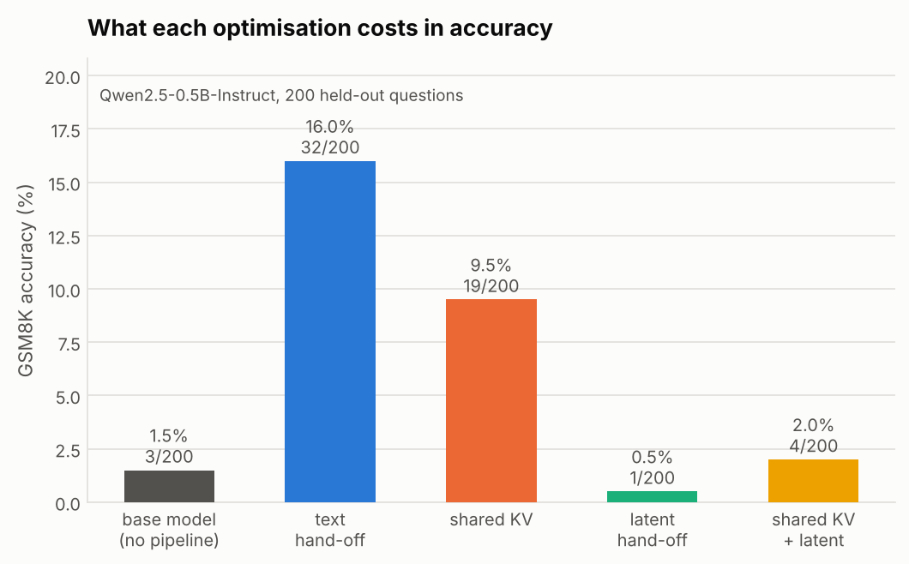
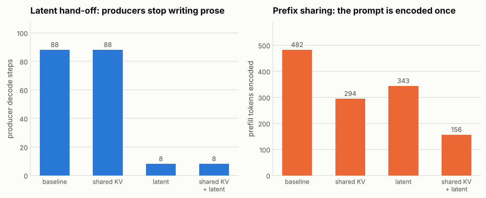
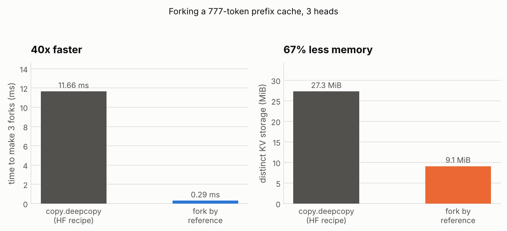

# Multi-Head Agent

**One frozen LLM, three LoRA role heads, a shared KV cache, and latent hand-offs.**

A multi-agent system usually pays for its roles twice: once in parameters —
a fine-tuned model per role — and once in tokens, because every role re-reads
the same prompt and each role serialises its thinking into text so the next
one can re-encode it.

This repo removes both costs on a real pretrained model, trains a role
adapter for each head, and measures what it costs in accuracy.

- **Roles are adapters, not models.** One frozen `AutoModelForCausalLM`, one
  named PEFT LoRA adapter per role. Switching heads is `set_adapter(name)` —
  no second model, no weight copy, no cache invalidation.
- **The prompt is encoded once.** The shared prefix is run through the
  adapter-free backbone into a `DynamicCache`, and every head *forks* it by
  reference. No head re-encodes the prompt.
- **Heads hand off activations, not prose.** Instead of decoding 48 tokens of
  plan for the next head to re-read, the producer decodes `k` steps and its
  hidden states are pooled into `k` latent vectors, injected downstream via
  `inputs_embeds`.

Four execution modes are benchmarked against each other, and all four are
evaluated for task accuracy, so the efficiency gain is reported next to its
price rather than on its own.

| mode | shared prefix KV | hand-off |
|---|---|---|
| `baseline` | no, each head re-encodes | natural language |
| `shared_kv` | yes, encoded once and forked | natural language |
| `latent` | no, each head re-encodes | pooled latent vectors |
| `shared_kv+latent` | yes, encoded once and forked | pooled latent vectors |

---

## Results

Backbone: **Qwen2.5-0.5B-Instruct**, LoRA rank 8, trained on 2000 GSM8K rows.
Accuracy on 200 held-out GSM8K questions; cost on an 8-task suite with decode
budgets fixed across modes. Single RTX 2050 (4 GB), bf16.

### The pipeline earns its keep

<picture>
  <source media="(prefers-color-scheme: dark)" srcset="results/torch/figures/01_accuracy_by_mode.dark.png">
  
</picture>

| configuration | accuracy | correct | vs text hand-off | Fisher p |
|---|---|---|---|---|
| `direct` — base model, no pipeline | 1.5% | 3/200 | — | — |
| **`pipeline_text`** — planner → critic → solver | **16.0%** | 32/200 | — | **1.4e-07** vs direct |
| `pipeline_shared_kv` — prefix encoded once | 9.5% | 19/200 | −6.5 pts | 0.071 |
| `pipeline_latent` — 4 latent slots per hand-off | 0.5% | 1/200 | −15.5 pts | 1.2e-10 |
| `pipeline_fast` — both | 2.0% | 4/200 | −14.0 pts | 1.5e-05 |
| `solver_gold` — solver head + gold plan | 91.5% | 183/200 | — | — |

Three LoRA heads and a plan-then-solve structure take a model that answers
3 of 200 questions correctly to 32 of 200 — a **10.7× relative improvement
for 1.6M trainable parameters**, p = 1.4e-07.

`solver_gold` at 91.5% is the solver head alone given a correct plan, with
answer leakage cut from 100% to 21% by masking, so it is largely computing
the final step rather than copying it. The gap between that and 16%
end-to-end is the planner's: most failures are bad plans, not bad solving.

### What the optimisations actually cost

<picture>
  <source media="(prefers-color-scheme: dark)" srcset="results/torch/figures/02_cost_breakdown.dark.png">
  
</picture>

| mode | producer decode steps | prefill tokens | total tokens | latency | KV bytes |
|---|---|---|---|---|---|
| `baseline` | 88 | 481.8 | 633.8 | 5.56 s | 7.79 MB |
| `shared_kv` | 88 | 294.3 (−38.9%) | 446.3 (−29.6%) | 5.66 s (**0.98×**) | 7.79 MB (−0%) |
| `latent` | **8 (−90.9%)** | 343.3 (−28.7%) | 415.3 (−34.5%) | 2.95 s (**1.88×**) | 5.10 MB (−34.5%) |
| `shared_kv+latent` | **8 (−90.9%)** | **155.8 (−67.7%)** | **227.8 (−64.1%)** | 2.94 s (**1.89×**) | 5.10 MB (−34.5%) |

Three findings worth stating plainly, two of them negative:

**Prefill savings do not become latency.** Prefix sharing removes 38.9% of
encoded tokens on its own (67.7% combined with latent hand-off) and buys **nothing** in wall-clock (0.98×, i.e. 2% slower).
Prefill is one batched forward pass; the 152 sequential decode steps
dominate. The saving is real for throughput and cost-per-request under
batching — it is not a latency optimisation, and reporting it as one would
have been wrong.

**Prefix sharing is not free in accuracy either.** Encoding the prefix
adapter-free costs 6.5 points (16.0% → 9.5%). At n=200 that is p=0.071 —
suggestive, not established — but it is the direction the design note
predicted, and it should be confirmed on a larger eval before being relied
on.

**Latent hand-off at 4 slots is catastrophic here.** It delivers the
largest cost win in the table — producer decode 88 → 8, a genuine 1.88×
end-to-end speedup — and destroys the task: 16.0% → 0.5%, p = 1.2e-10.
Compressing a 48-token plan into 4 vectors, with a bridge trained on
gold-plan activations but run on generated ones, loses the plan. This is
reported as a negative result rather than buried: the mechanism works, the
compression ratio does not.

### Forking the cache beats HuggingFace's documented recipe

<picture>
  <source media="(prefers-color-scheme: dark)" srcset="results/torch/figures/03_cache_fork.dark.png">
  
</picture>

For a 777-token prefix shared by 3 heads: **40× faster** (0.29 ms vs 11.66
ms) and **66.7% less KV storage** (9.1 MiB vs 27.3 MiB), with logits
identical to both the deepcopy route and a full re-encode — asserted in the
test suite, not assumed.

### Parameters

| | |
|---|---|
| frozen backbone | 494.0 M |
| LoRA per role head | **540.7 K (0.109%)** |
| three heads total | 1.62 M trainable |
| vs one fine-tuned model per role | **−66.6% parameters** |

### Where it still falls short

The **critic head does not work**: 57.0% against a 53.0% majority-class
baseline, p = 0.48. Not distinguishable from always guessing. Switching its
negatives from arithmetic perturbation to grounding violations lifted
perturbed-plan recall from 5.7% to 47.2% and stopped it answering OK
unconditionally, but it still contributes nothing measurable. A 0.5B model
checking a multi-step plan is likely the limit.

## Quickstart

```bash
git clone https://github.com/<you>/multi-head-agent
cd multi-head-agent
pip install -r requirements.txt
```

For CUDA, install torch for your toolkit first:
`pip install torch --index-url https://download.pytorch.org/whl/cu121`

```bash
python -m pytest tests -q            # fast; tiny random model, no big download
python -m mha_torch.verify           # correctness against a real model
python -m mha_torch.train --train-size 2000
python -m mha_torch.train_latent --train-size 1500
python -m mha_torch.evaluate --limit 200
python -m mha_torch.bench --tasks 8
python scripts/make_plots.py
```

On Windows: `powershell -ExecutionPolicy Bypass -File run_all.ps1`.
Device is auto-detected (CUDA, MPS, else CPU).

### Fitting a small GPU

The default backbone is `SmolLM2-135M-Instruct`, which trains comfortably in
4 GB. Knobs, in the order worth reaching for:

```bash
python -m mha_torch.train --batch-size 1 --grad-accum 8 --max-len 384 --grad-checkpoint
```

- `--batch-size` / `--grad-accum` — effective batch is their product, so you
  can shrink memory without changing the optimisation.
- `--max-len` — attention memory grows with sequence length; 384 is usually
  enough for GSM8K prompts plus a plan.
- `--grad-checkpoint` — recomputes activations instead of storing them.
  Roughly 30% slower, and the biggest single saving.
- `--dtype bf16` — on Ampere and newer (an RTX 2050 qualifies). `auto`
  already picks it on a supported GPU.
- `--model HuggingFaceTB/SmolLM2-360M-Instruct` — a stronger backbone that
  still fits; only the LoRA parameters are trained, so the optimiser state
  stays small.

Peak VRAM is printed with the training loss, so you can see the headroom you
have before changing anything.

---

## How it works

```
mha_torch/
  backbone.py   frozen AutoModelForCausalLM + one named PEFT LoRA adapter per
                role; set_adapter() switches heads, disable_adapter() gives the
                bare backbone that encodes the shared prefix
  cache.py      forks a prefilled DynamicCache by reference
  compat.py     transformers v4/v5 shims (cache kwarg, per-layer storage)
  latent.py     the latent bridge, a trainable nn.Module (save/load)
  pipeline.py   the four execution modes, with measurement built in
  data.py       role supervision derived from GSM8K
  train.py      LoRA training, one adapter per role, loss masked to targets
  train_latent.py  stage two: trains the bridge + solver on a mixed
                text/latent objective, so one solver head reads either
  evaluate.py   GSM8K accuracy for four configurations, cost reported beside it
  bench.py      efficiency across modes, plus fork vs deepcopy
  verify.py     correctness checks against a real model — run this first
  stats.py      exact Fisher tests, so every accuracy delta carries a p-value
```

### Forking the cache instead of copying it

HuggingFace's documented recipe for reusing a prefilled prompt cache is
`copy.deepcopy(prompt_cache)` per continuation. That is correct but
duplicates every prefix tensor.

It is also unnecessary. `DynamicLayer.update` does
`self.keys = torch.cat([self.keys, key_states], dim=-2)` — it allocates a new
tensor and rebinds, never writing into the existing one. So several children
can hold references to the *same* prefix tensors safely: the first append on
any child rebinds that child's own attribute and leaves the shared tensor
untouched.

`fork_cache` therefore copies the container and the per-layer objects while
sharing the tensors, and the test suite asserts it produces logits identical
to both a full re-encode and the deepcopy route.

Worth stating plainly: because HF caches are concatenation-based, the *memory*
saving lasts only until each child's first append, after which that child
holds a full-length tensor of its own. The *compute* saving — never
re-encoding the shared prefix — is permanent, and it is the dominant cost. A
genuinely paged cache is what would fix the memory side too.

### Why the prefix is encoded adapter-free

A prefix encoded with the Planner's LoRA weights is not the prefix the Critic
would have produced. Encoding it through the frozen backbone with
`disable_adapter()` makes the KV blocks exactly reusable by every head; role
adapters then apply to each head's own suffix and to all of its decode steps.
This is a deliberate trade, and `evaluate.py` measures what it costs.

### Two training stages

`train.py` fits one LoRA adapter per role on text. `train_latent.py` then
trains the bridge with a teacher-forced objective: run the planner over the
*gold* plan, pool its hidden states into `k` slots, and have the solver
predict the answer from `[question][slots][instruction]`, with loss on the
answer tokens only. Batches alternate between that and the plain text form,
so the single solver head stays able to read either — which is what the
four-mode benchmark assumes.

The honest caveat: training pools gold-plan activations while inference
pools the planner's generated ones, so there is a teacher-forcing gap.
Closing it means sampling from the planner during training, which costs
much more compute.

### Role supervision

A multi-role pipeline needs role-specific targets, which a plain instruction
dataset does not provide. GSM8K does, once split:

- **planner** — question → the reasoning steps, with the final answer stripped.
- **solver** — question + plan → the final numeric answer.
- **critic** — question + plan → a verdict. Half the examples carry a
  deliberately perturbed number, because a critic trained only on correct
  plans learns to say "looks fine" every time: a constant function that
  scores well and means nothing.

  The perturbation targets a number the plan **copied from the question**, in
  preference to any other. That was a correction, not the original design:
  arithmetic-only negatives gave a 135M backbone nothing it could learn, and
  it collapsed to answering OK unconditionally — 5.7% recall on perturbed
  plans, below the majority-class baseline. Breaking the plan's grounding in
  the question is checkable without re-deriving the arithmetic.
  `evaluate.py` reports per-class accuracy and the majority baseline so this
  failure mode stays visible.

Each adapter is trained separately: activate that role, freeze every other
parameter, and run masked next-token prediction on its own targets, with loss
on the target span only.

---

## Tests

```
$ python -m pytest tests -q
```

The dataset layer has no torch dependency and is tested without one; package
imports are lazy (PEP 562) so that stays true. The rest runs against a tiny
randomly-initialised model, so CI checks the real invariants on every push
without downloading weights:

- a forked prefix cache gives logits identical to a full re-encode;
- forking matches HuggingFace's `deepcopy` recipe exactly, for less memory;
- a fork never mutates its parent, and siblings never corrupt each other;
- latent vectors are consumable through `inputs_embeds` on a populated cache;
- every execution mode runs, and the combined mode is the cheapest;
- greedy runs are reproducible.

Point the suite at a real model with `MHA_TEST_MODEL=...` to check the same
invariants at full scale, or run `python -m mha_torch.verify`.

---

## Limitations

- **Prefix sharing saves compute, not memory**, on a concatenation-based HF
  cache. See above.
- **Latent hand-off is lossy compression** by construction, and the bridge
  has to be trained for it to carry anything: `train.py` fits the role
  adapters only, so `train_latent.py` is a required second stage. With an
  untrained bridge the latent path injects noise — measured on
  SmolLM2-135M, 0.5% against 3.0% for the text pipeline. `evaluate.py`
  refuses to report latent accuracy silently without a trained bridge.
- **Accuracy depends on your run.** A 135M backbone is weak at GSM8K; the
  `direct` floor and `solver_gold` ceiling are reported alongside, so a low
  number is legible rather than hidden. A larger backbone gives a stronger
  signal if you have the VRAM.
- **Latency is measured, not projected** — single process, single GPU, with
  CUDA synchronised before timing. It is not a claim about server throughput.
- **Cost comparisons fix the decode budget across modes.** Changing the mode
  shifts the output distribution, so heads hit EOS at different points; an
  earlier run reported `shared_kv` as 47% *worse* on generated tokens purely
  because of that. `bench.py` disables early stopping by default for this
  reason; `--allow-early-stop` restores realistic decoding.
- **n = 200 questions.** A 6.5-point difference is not significant at that
  size (p = 0.071). Every accuracy delta in the results table carries its
  Fisher p-value so the under-powered ones are visible.

## License

MIT.
